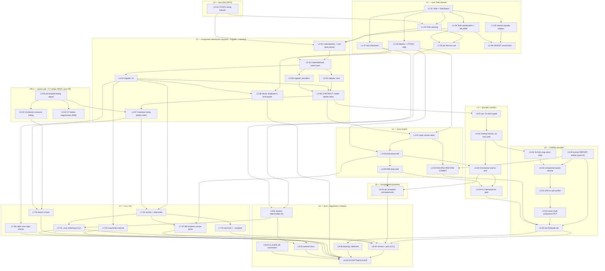

# VTODO ticket index — the dependency graph

**Scope:** this file is the DAG only. Ticket bodies are written by a later wave of agents from
the rows below. Do not treat a row as a body.

**Binding inputs:** `docs/vtodo/spec.md` (R1–R108), `docs/vtodo/adr/ADJUDICATION.md` (wins over
any ADR), `docs/vtodo/context/testing.md`, `docs/vtodo/reproduction.md`.

**Sizing contract:** every ticket below is scoped to ≤ ~4 closely-related files and 2–4 modules
of required understanding. Where a ticket exceeds that it is called out in §Risk.

---

## 0a. Standing corrections — read before opening any ticket

These four rulings are global. They override any row, body or ADR sentence that contradicts them.

**① Line numbers in this doc set are stale by 1–2 lines. Grep the SYMBOL, never the number.**
The ADJUDICATION files this as a known systematic defect (`calendar_diff.rs:78-90` is really
`:76-90`; `connection.rs:231` is really `:232`). Every `file.rs:NN` below is a *navigation hint*.
If the symbol is not on that line, it is within a few lines of it — searching for the number and
finding something else is not a discrepancy to report, it is the expected drift.

**② The RED-test adaptation gate is GLOBAL, not `L2-06`-specific.**
Per the ADJUDICATION's extended ruling: **any** ticket in **any** layer that breaks compilation of
one of the five immutable RED tests (or their VEVENT controls) carries a **named review gate**:
- assertions immutable — no weakening, no removal, no changed expected value, no reorder-into-irrelevance;
- test **names** immutable (they are the citation handle in spec §18 and `reproduction.md`);
- accessors adaptable, but only as a mechanical rename with the assertion line itself untouched;
- the ticket's reviewer **MUST** diff the affected tests before/after and confirm no assertion drifted.

The tickets carrying the gate, and what each breaks (all grep-verified):

| Ticket | Breaks | How |
|---|---|---|
| `L0-01` | `calendar::tests::events_lists_a_vtodo_file_alongside_its_vevent_sibling` (`calendar.rs:1161`); controls `calendar::tests::events_lists_the_vevent_control_file` (`:1191`) and `caldir::tests::vevent_calendar_lists_independently_of_a_sibling_vtodo_calendar` (`caldir.rs:417`) | `Calendar::events()` returns a listing struct, not `Result<Vec<_>>` |
| `L2-02` | *conditionally* `calendar::event::tests::load_reads_a_vtodo_file` (`calendar/event.rs:539`) | only if `CalendarEventError::ExpectedSingleEvent { found, .. }` — matched in that test's `Err` arm — is renamed or reshaped. Keep the variant and the gate does not fire. |
| `L2-06` | `event::tests::from_ics_str_parses_a_vtodo_document`, `event::tests::from_single_ics_str_parses_a_vtodo_document`, `calendar::event::tests::load_reads_a_vtodo_file`; controls `event::tests::from_single_ics_str_parses_the_vevent_control_document`, `event::tests::from_ics_str_yields_nothing_for_a_component_less_document`, `calendar::event::tests::load_reads_the_vevent_control_file` | `from_ics_str` → `Vec<Result<CalendarItem, _>>`, `from_single_ics_str` → `CalendarItem`, `event()` → `Option<&Event>` |
| `L2-07` | `caldir::tests::aggregating_all_calendars_survives_a_vtodo_calendar` (`caldir.rs:424`) | its `filter_map(|e| e.summary)` reads a field off `Event`; `expanded_events_in_range` yields `CalendarItem`, which has no `.summary` field |

**③ The `409 <C:no-uid-conflict/>` trigger is a SERVER-ASSIGNED FILENAME, not a local rename.**
Lead-engineer correction: the href is UID-derived (`event_url`, `caldav/client.rs:73-76`) and used
unconditionally at `create_event.rs:26`, so a local rename yields the **same** href — a 412 under
`If-None-Match: *`, or a 204 overwrite. The reachable 409 is *a resource at another href already
holding that UID*, which is exactly what `find_event_location`'s REPORT fallback exists for. The
requirement (R63/R79/R103) stands unchanged; the trigger stated in the spec and in three ticket
briefs is wrong. **Tests MUST assert the OUTCOME (one resource, correct body, no duplicate), never
the status code.**

**④ MAINTAINER DECISION POINT — new dev-dependency `wiremock = "0.6"`.**
`L5-02`, `L5-03` and `L5-04` need an HTTP double to assert on request bodies without a live server.
`caldir-provider-caldav`'s only dev-dependency today is `tempfile = "3"`. Adding `wiremock` is a
**new transitive test-dependency for the upstream PR** and must be signed off before those tickets
start, not discovered in review.
*Stated fallback if it is refused:* `T-40` collapses to a pure response-classifier unit test (feed
the classifier a synthetic `409` + `<C:no-uid-conflict/>` body, assert it selects the
update-fallback branch), with the end-to-end proof moving to the live tier (`L5-05`). `T-39` and
`T-41` survive the fallback because `L5-00` makes the request bodies constructible without a
transport at all.

---

## 0. The two PRs

| PR | Tickets | Why separate |
|---|---|---|
| **PR-1 — graceful degradation + C7** | `L0-01`, `L0-02`, `L0-03` | R6 is explicit: level-2/level-3 blast radius is a **pre-existing defect independent of VTODO modelling**, and it SHOULD ship first as its own change — **and that change MUST include R48**, because a degrading core paired with a VTODO-aware provider deletes the user's tasks server-side (C7). |
| **PR-2 — the VTODO feature** | everything else (`L0-04`, `L1-*` … `L8-*`) | The feature proper. Depends on PR-1 having landed. |

### Sequencing finding that changes the plan — read this

**PR-1 does not turn any of the five RED tests green.** All five assert that the VTODO *loads
and is visible*, not merely that it fails softly:

- `events_lists_a_vtodo_file_alongside_its_vevent_sibling` asserts `uids == ["assignment-123@u-crawler", "window-123@u-crawler"]` — the task must be **listed**, not skipped.
- `aggregating_all_calendars_survives_a_vtodo_calendar` asserts the task's **summary is in the aggregate**.
- the three parse/load tests assert `uid` / `summary` on a loaded item.

So PR-1 lands with **its own new tests** (`T-29`, plus degradation/doctor locks), and the five
RED tests go green in **L2-06 / L2-07**. See §Risk R1 for the immutability conflict this creates.

---

## 1. Ticket table

Columns: `id` · responsibility · R-ids · files · depends-on · RED/named tests · verify.

Verification shorthand:
- `CT` = `cargo test -p caldir-core --lib -- --exact <test path>`
- `TZ3 <cmd>` = `for tz in UTC Europe/Stockholm America/New_York; do TZ=$tz <cmd> || exit 1; done`
- `CHECK` = `just check` (cargo check --workspace + clippy -D warnings)
- `SUITE` = `just test` (== `cargo test`, 686-test baseline)

**Ticket totals after reconciliation — 48 tickets:**

| Layer | Before | After | Delta |
|---|---|---|---|
| L0 | 4 | 4 | — |
| L1 | 8 | 8 | — |
| L2 | 8 | 8 | — |
| L3 | 4 | 4 | — |
| L4 | 4 | 4 | — |
| L5 | 5 | **6** | **+1** (`L5-00`) |
| L6 | 1 | 1 | — |
| L7 | 6 | **7** | **+1** (`L7-07`) |
| L8 | 6 | 6 | — |
| **Total** | **46** | **48** | **+2** |

### L0 — repro / degradation infrastructure

#### `L0-01` — incomplete-listing signal on `Calendar::events()`  ·  **PR-1**
- **Responsibility:** `Calendar::events()` stops `?`-aborting on one bad file; it returns loaded events **plus a record of skipped files** (settles Q-6 by changing the return to a small listing struct).
- **Satisfies:** R6 (part), R74 (mode-A half), R78, R5 (level 2)
- **Files:** `caldir-core/src/calendar.rs`, `caldir-core/src/calendar/error.rs`, `caldir-core/src/connection.rs` *(call sites `:38`, `:68`, `:98`, `:125`)*, `caldir-cli/src/commands/rsvp.rs` *(call site `:91`)*
- **Depends on:** —
- **⚑ Carries the RED-test review gate** (§0a ②) — three tests, listed there.
- **Tests:** new: `calendar::tests::an_unreadable_file_is_skipped_and_reported_not_fatal`
- **Compile-completeness note:** retyping `Calendar::events()` is **not** contained in `calendar.rs`. Grep-verified non-test callers: `connection.rs:38,68,98,125`, `caldir-cli/src/commands/rsvp.rs:91`, `caldir-cli/src/commands/doctor.rs:55` *(`L0-02`)*, `caldir-cli/src/output/agenda.rs` *(`L0-02`)*. Test callers that also stop compiling: `calendar.rs:467,468,482,552,1168,1193`, `connection.rs:530,564,657`, `caldir.rs:417`, `caldir-cli/.../duplicate_file.rs:68,84`. `just check` is workspace-wide, so this ticket is not green until the CLI sites it owns compile.
- **Verify:** `CHECK && CT calendar::tests::an_unreadable_file_is_skipped_and_reported_not_fatal && SUITE`

#### `L0-02` — CLI + doctor consume the listing without changing a byte of text  ·  **PR-1**
- **Responsibility:** `AgendaView::collect` no longer aborts the whole aggregation on one bad calendar; `doctor` still reports a broken VEVENT as `UnreadableEvents`.
- **Satisfies:** R5 (level 3), R77, C13
- **Files:** `caldir-cli/src/output/agenda.rs`, `caldir-cli/src/commands/doctor.rs`
- **Depends on:** `L0-01`
- **Tests:** `T-43` `commands::doctor::tests::a_malformed_vevent_is_still_a_warning_after_component_skipping` — **this test does not exist yet and must be written new**; new: `output::agenda::tests::one_broken_calendar_does_not_blank_the_agenda`
- **⚠ `T-43` correction:** the only doctor test on disk is `commands::doctor::tests::treats_unreadable_events_as_warnings` (`caldir-cli/src/commands/doctor.rs:76`), and its fixture is a **component-less** `BEGIN:VCALENDAR\nVERSION:2.0\nEND:VCALENDAR` — not a malformed one. It exercises the arity path, not the parse path, so it cannot stand in for `T-43`. **Leave it untouched** (it is an R2 control) and add `T-43` beside it with a genuinely broken **VEVENT** — e.g. a `BEGIN:VEVENT` with a corrupt `DTSTART` value and no `END:VEVENT`.
- **Verify:** `CHECK && cargo test -p caldir-cli && SUITE`

#### `L0-03` — C7 guard: a calendar with any unreadable file emits **zero** deletes  ·  **PR-1**
- **Responsibility:** thread the incomplete-listing signal into diff computation and suppress every delete, both directions, for that calendar that sync.
- **Satisfies:** R48 (INVIOLABLE), R74 (the "fix for A must not create B" clause), C7
- **Files:** `caldir-core/src/diff/calendar_diff.rs`, `caldir-core/src/connection.rs`
- **Depends on:** `L0-01`
- **Tests:** `T-29` `diff::calendar_diff::tests::unreadable_local_files_suppress_all_deletes`
- **Verify:** `CHECK && CT diff::calendar_diff::tests::unreadable_local_files_suppress_all_deletes && SUITE`

#### `L0-04` — VTODO string fixtures for the whole feature  ·  PR-2
- **Responsibility:** add the inline `\r\n` ICS string constants the later tickets need — mixed VEVENT+VTODO, VJOURNAL/X-FOO, undated task, zoned `DUE` + floating `COMPLETED`, unknown `STATUS`, out-of-range `PRIORITY`, two `RELATED-TO` lines. **Strings only, no new types**, so it has no dependency.
- **Satisfies:** (no R of its own — enabling infrastructure; see §Coverage orphan note)
- **Files:** `caldir-core/src/test_utils.rs`
- **Depends on:** —
- **Tests:** none of its own
- **Verify:** `CHECK && SUITE`

### L1 — core Todo domain

#### `L1-01` — the `Todo` struct and `TodoStatus`
- **Responsibility:** `pub struct Todo` with the MVP field set (ADR-01 #3 as amended by C-2) and a **distinct four-valued** `TodoStatus`. No codec, no equality, no `end`, no `availability`.
- **Satisfies:** R7 (domain half), R8 (structurally — no `end` field exists), R9, R13 (field set), R93
- **Files:** `caldir-core/src/todo.rs` *(new)*, `caldir-core/src/todo/status.rs` *(new)*, `caldir-core/src/lib.rs`
- **Depends on:** —
- **Tests:** new: `todo::status::tests::the_four_task_statuses_round_trip`
- **Verify:** `CHECK && cargo test -p caldir-core --lib -- todo::status`

#### `L1-02` — shared equality helpers, referenced by both types
- **Responsibility:** move `x_properties_eq` / `attachments_eq` out of `event.rs` into a `pub(crate)` module and point **both** `Event` and `Todo` educe attrs at the same fns, making drift structurally impossible. Then write `Todo`'s `PartialEq`.
- **Satisfies:** R12, R38, R39
- **Files:** `caldir-core/src/event/equality.rs` *(new)*, `caldir-core/src/event.rs`, `caldir-core/src/todo.rs`
- **Depends on:** `L1-01`
- **Tests:** `T-18` `todo::tests::equality_mirrors_event_equality`
- **Verify:** `CHECK && CT todo::tests::equality_mirrors_event_equality && SUITE` *(SUITE is the R2 guard — `Event`'s equality must not move)*

#### `L1-03` — Todo ICS **parsing** for the MVP property set
- **Responsibility:** VTODO → `Todo`. Raw `STATUS`, raw `PRIORITY`, caldir's own time parser for `COMPLETED`, TZID normalization on `DUE`/`DTSTART`, `X-*` capture with the event filter, no `DTSTART` requirement.
- **Satisfies:** R13 (IN-set parse), R14, R20, R21, R22, R23, R68
- **Files:** `caldir-core/src/todo/from_icalendar.rs` *(new)*, `caldir-core/src/todo.rs`
- **Depends on:** `L1-01`, `L0-04`
- **Tests:** `T-13` `todo::from_icalendar::tests::zoned_due_and_floating_completed_round_trip` **(TZ)**; `T-14` `todo::tests::an_unknown_status_value_is_preserved_or_explicitly_dropped`; `T-15` `todo::tests::priority_out_of_rfc_range_round_trips_verbatim`
- **Verify:** `TZ3 "cargo test -p caldir-core --lib -- todo::from_icalendar todo::tests::an_unknown_status todo::tests::priority_out_of"`

#### `L1-04` — Todo ICS **serialization**, incl. the hand-rolled VALARM splice
- **Responsibility:** `Todo` → single-component `VCALENDAR`, CRLF, `DTSTAMP` re-stamped (never a field), VALARM spliced on the literal `"END:VTODO\r\n"`. **Never** call `ends()`/`all_day()`; never emit `DTEND`/`DURATION`.
- **Satisfies:** R8, R24, R25, R26, R27, R28, R29 (tolerate side)
- **Files:** `caldir-core/src/todo/to_icalendar.rs` *(new)*, `caldir-core/src/todo.rs`
- **Depends on:** `L1-01`
- **Tests:** `T-11` `todo::to_icalendar::tests::serializing_a_task_never_emits_dtend`; `T-12` `todo::tests::valarm_is_byte_stable_across_three_generations`; `T-19` `todo::tests::two_serializations_with_different_wall_clocks_compare_equal`
- **Verify:** `CHECK && cargo test -p caldir-core --lib -- todo::to_icalendar todo::tests::valarm todo::tests::two_serializations`

#### `L1-05` — pin the documented loss set
- **Responsibility:** tests only. Assert the dropped-property list is **exactly** the documented one, and pin the known `RELATED-TO` collapse.
- **Satisfies:** R15, R87, R88
- **Files:** `caldir-core/src/todo.rs` *(test module)*
- **Depends on:** `L1-03`, `L1-04`
- **Tests:** `T-16` `todo::tests::two_related_to_lines_collapse_to_one`; `T-17` `todo::tests::dropped_property_names_are_exactly_the_documented_list`
- **Verify:** `CHECK && cargo test -p caldir-core --lib -- todo::tests::two_related_to todo::tests::dropped_property_names`

#### `L1-06` — identity gains `ComponentKind`; the `VTODO:` sigil
- **Responsibility:** `EventInstanceId` carries kind (ADJUDICATION C-1; ADR-01 #7 struck). String form byte-identical for events, `VTODO:{uid}[__{rid}]` for tasks; parsing stays infallible. `known_event_ids` writes/reads the sigil in the same file.
- **Satisfies:** R36, R37, C4 (amended)
- **Files:** `caldir-core/src/event/instance_id.rs`, `caldir-core/src/calendar/state/known_event_ids.rs`
- **Depends on:** `L1-01`
- **Tests:** `T-20` `event::instance_id::tests::parse_of_format_is_identity_for_both_kinds`; `T-21` `calendar::state::known_event_ids::tests::event_form_lines_are_byte_identical_and_task_lines_are_prefixed`
- **Verify:** `CHECK && cargo test -p caldir-core --lib -- instance_id known_event_ids && SUITE`

#### `L1-07` — task filenames
- **Responsibility:** the `_task__` reserved-prefix convention (recurring / dated / undated), reusing `time_slug()` verbatim. **`Event::base_slug()` is not touched.**
- **Satisfies:** R33, R34, R35, C1 (INVIOLABLE)
- **Files:** `caldir-core/src/todo/slugify.rs` *(new)*, `caldir-core/src/event/slugify.rs` *(extract shared helpers)*
- **⚠ "visibility only" is not achievable — corrected scope:** grep-verified, `time_slug()` (`event/slugify.rs:48`) and `summary_slug()` (`:21`) are **private methods on `Event`** reading `self.start` / `self.summary`. A `Todo` has neither in that shape (`due: Option<…>`, and no `start` at all for an undated task). The real work is: **extract both as `pub(crate)` free functions** taking the value they slug (`fn time_slug(t: &EventTime) -> String`, `fn summary_slug(s: Option<&str>) -> String`), have `Event`'s methods **delegate** to them unchanged, and prove the delegation is behaviour-preserving with `T-6`. `Event::base_slug()` (`:13`) still is not touched — C1 is INVIOLABLE.
- **Depends on:** `L1-01`
- **Tests:** `T-6` `event::slugify::tests::base_slug_is_unchanged_for_vevent_corpus` **(TZ)**; `T-7` `event::slugify::tests::task_filenames_cover_recurring_dated_and_undated` **(TZ)**
- **Verify:** `TZ3 "cargo test -p caldir-core --lib -- slugify"`

#### `L1-08` — VEVENT no-regression control lock
- **Responsibility:** tests only. Lock R2/C2: an existing VEVENT parses to a structurally `==` event and re-serializes byte-identically after `Todo` exists; `occurs_in_range` unchanged.
- **Satisfies:** R1, R2 (INVIOLABLE), R45, R104, C2
- **Files:** `caldir-core/src/event.rs` *(test module)*
- **Depends on:** `L1-02`, `L1-04`
- **Tests:** `T-5` `event::tests::vevent_control_round_trips_identically_after_vtodo_support` **(TZ)**
- **Verify:** `TZ3 "cargo test -p caldir-core --lib -- event::tests::vevent_control"`

### L2 — component abstraction / local calendar  *(expand → migrate → contract)*

#### `L2-01` — **expand:** `CalendarItem` + the one-ordered-pass parser, as a *new* API
- **Responsibility:** `pub enum CalendarItem { Event(Event), Todo(Todo) }` and `CalendarItem::from_ics_str` making **one ordered pass** over `icalendar.components` — `VEVENT → Event`, `VTODO → Todo`, `VTIMEZONE → ignored`, anything else → **hard error naming it**. Arity errors distinguish "none (found: names|nothing)" from "too many". `Event::from_ics_str` keeps its current signature, delegating. Nothing else changes yet.
- **Satisfies:** R7, R10, R17, R18 (disk loader), R19 (INVIOLABLE), R32, R75, R76, R93, R101
- **Files:** `caldir-core/src/item.rs` *(new)*, `caldir-core/src/event.rs`, `caldir-core/src/event/error.rs`, `caldir-core/src/lib.rs`
- **Depends on:** `L1-03`, `L1-04`, `L0-04`
- **Tests:** `T-1` `event::tests::from_ics_str_parses_a_vtodo_document` *(enabled here, green at L2-06)*; `T-8` `calendar::event::tests::arity_table_all_eight_rows` — **partial rows only, see below**; `T-9` `event::tests::an_unsupported_component_errors_and_names_it`
- **⚠ `T-8` is split across two tickets.** It lives in `caldir-core/src/calendar/event.rs`, i.e. at the `CalendarEvent::load` seam, and the task-bearing rows of the eight-row table cannot pass until the loader actually admits a task at `L2-06`. **Here:** write the whole eight-row table and make the event-side and error-side rows (zero components, VEVENT×1, VEVENT×2, unsupported component) pass; task rows may be `#[ignore]`d **with a comment naming `L2-06`**, never deleted or weakened. **`L2-06` owns the full pass** as an acceptance criterion. The test name and its eight rows are fixed at `L2-01`; only the ignore markers move.
- **Verify:** `CHECK && cargo test -p caldir-core --lib -- item:: event::tests::an_unsupported && SUITE`

#### `L2-02` — **expand:** `CalendarEvent` stores a `CalendarItem`
- **Responsibility:** retype the field to `CalendarItem`; add `item()` and `as_event() -> Option<&Event>`. Keep the legacy `event() -> &Event` accessor temporarily (unreachable for tasks — the loader still cannot produce one until `L2-06`), so CI stays green with zero call-site churn.
- **Satisfies:** R11, R32 (writer safety)
- **Files:** `caldir-core/src/calendar/event.rs`, `caldir-core/src/calendar/event/error.rs`
- **Depends on:** `L2-01`, `L1-07`
- **Tests:** new: `calendar::event::tests::an_item_backed_calendar_event_is_still_byte_identical_for_events`
- **Verify:** `CHECK && SUITE`

#### `L2-03` — **migrate batch 1:** `caldir-core` call sites
- **Responsibility:** mechanically re-point core's `.event()` call sites to `item()` / `as_event()`. Behaviour-preserving; CI green because the legacy accessor still exists.
- **Satisfies:** — *(mechanical migration; no R of its own)*
- **Files:** `caldir-core/src/diff/calendar_diff.rs` *(20 sites)*, `caldir-core/src/calendar.rs` *(18)*, `caldir-core/src/calendar/event.rs` *(16)*, `caldir-core/src/connection.rs` *(11)* — 65 sites, grep-verified
- **⚠ File-list correction:** `caldir-core/src/calendar/state/*.rs` has **zero** `.event()` sites and is **not** in scope here — the state modules reach events through `Event::load_single`, which is `L3-01`'s concern. `caldir-core/src/calendar/event.rs` **is** in scope (16 sites) and was missing; it is the same file `L2-02` retypes, so `L2-02` and `L2-03` must not run concurrently.
- **Depends on:** `L2-02`
- **Tests:** none new — `SUITE` is the gate
- **Verify:** `CHECK && SUITE`

#### `L2-04` — **migrate batch 2:** `caldir-cli` call sites
- **Responsibility:** same migration for the CLI. VEVENT-only consumers gain a `let Some(e) = … else { continue }` narrowing rather than a rewrite.
- **Satisfies:** — *(mechanical migration)*
- **Files:** `caldir-cli/src/commands/rsvp.rs` *(4 sites: `:92`, `:102`, and 2 more)*, `caldir-cli/src/commands/doctor/warning/duplicate_file.rs` *(1 site)*
- **⚠ File-list correction:** grep-verified, those are the CLI's **only** `CalendarEvent::event()` call sites — two files, not four. `output/agenda.rs`, `output/event.rs`, `commands/status.rs` and `commands/discard.rs` carry **zero**: `agenda.rs`/`event.rs` read `.event` off the **CLI's own `AgendaEntry`**, which is a different type and breaks at `L2-07` (listing yields items), not here; `status.rs`/`discard.rs` reach events only through `CalendarDiff`/`EventChange`, which retype at `L3-03` and render at `L7-07`. This ticket is much smaller than the row implied.
- **Depends on:** `L2-02`
- **Tests:** none new — `cargo test -p caldir-cli` is the gate
- **Verify:** `CHECK && cargo test -p caldir-cli && SUITE`

#### `L2-05` — **migrate batch 3:** provider crates compile against the new core API
- **Responsibility:** mechanical narrowing in the five provider crates so the workspace builds. **No behavioural change, no VTODO support added** (R70/R73: no provider-crate edits ship in this feature beyond compiling).
- **Satisfies:** R70 (by not editing behaviour), R73
- **Files:** `caldir-provider-google/src/google_event/from_google.rs`, `caldir-provider-outlook/src/graph_api/types/mod.rs`, `caldir-provider-webcal/src/commands/list_events.rs`, `caldir-provider-icloud/src/**` *(only where the API break reaches)*
- **Depends on:** `L2-02`
- **Tests:** none new — `cargo test --workspace` is the gate
- **Verify:** `CHECK && cargo test --workspace --no-fail-fast`
- **⚑ REVIEW GATE, not guaranteed work. A clean `cargo check --workspace` is a valid and complete outcome.** `L2-02` deliberately keeps the legacy `event()` accessor alive precisely so the provider crates need no edit. If the workspace already builds, the deliverable is a one-line report saying so — **do not invent narrowing, refactors or VTODO handling to justify the ticket** (R70/R73 forbid provider behaviour changes outright). The ticket exists to make "nothing broke" an explicitly checked, signed-off fact before `L2-06` deletes the accessor.

#### `L2-06` — **contract:** the loader admits tasks  ⚑ *the green moment*
- **Responsibility:** delete the legacy accessors; retype `Event::from_ics_str` → `Vec<Result<CalendarItem, _>>` and `from_single_ics_str` → `CalendarItem`; `CalendarEvent::load` returns a task for a VTODO file; `event()` becomes `Option<&Event>`.
- **Satisfies:** R5 (load half), R32
- **Files:** `caldir-core/src/event.rs`, `caldir-core/src/calendar/event.rs`, `caldir-core/src/item.rs`
- **Depends on:** `L2-03`, `L2-04`, `L2-05`
- **⚑ Carries the RED-test review gate** (§0a ②) — six tests, listed there.
- **Also owns:** the **full** eight-row pass of `T-8` (`calendar::event::tests::arity_table_all_eight_rows`), whose task rows `L2-01` left ignored. Un-ignoring them is an acceptance criterion of this ticket, not a follow-up.
- **RED tests it must turn green:** `event::tests::from_ics_str_parses_a_vtodo_document`, `event::tests::from_single_ics_str_parses_a_vtodo_document`, `calendar::event::tests::load_reads_a_vtodo_file` *(= `T-1`, `T-2`)*
- **Verify:** `CT event::tests::from_ics_str_parses_a_vtodo_document && CT event::tests::from_single_ics_str_parses_a_vtodo_document && CT calendar::event::tests::load_reads_a_vtodo_file && SUITE`

#### `L2-07` — `Calendar::events()` / `expanded_events_in_range` list tasks  ⚑ *the green moment, level 2+3*
- **Responsibility:** tasks flow through the listing and into range expansion. A recurring task's RRULE is **modelled, never expanded** (master only); an undated task is never given an invented date.
- **Satisfies:** R3, R4, R5 (levels 2 and 3, fully), R89
- **Files:** `caldir-core/src/calendar.rs`, `caldir-core/src/caldir.rs`
- **Depends on:** `L2-06`, `L0-01`
- **⚑ Carries the RED-test review gate** (§0a ②) — `caldir::tests::aggregating_all_calendars_survives_a_vtodo_calendar` stops compiling here because `expanded_events_in_range` yields items and its `filter_map(|e| e.summary)` reads a field off `Event`.
- **RED tests it must turn green:** `calendar::tests::events_lists_a_vtodo_file_alongside_its_vevent_sibling`, `caldir::tests::aggregating_all_calendars_survives_a_vtodo_calendar` *(= `T-3`, `T-4`)*
- **Verify:** `CT calendar::tests::events_lists_a_vtodo_file_alongside_its_vevent_sibling && CT caldir::tests::aggregating_all_calendars_survives_a_vtodo_calendar && SUITE`

#### `L2-08` — `doctor` duplicate detection is kind-aware
- **Responsibility:** an event/task UID pair is two legitimate files, not a duplicate (R36 hazard 5).
- **Satisfies:** R36 (hazard 5)
- **Files:** `caldir-cli/src/commands/doctor/warning/duplicate_file.rs`
- **Depends on:** `L1-06`, `L2-04`
- **Tests:** `T-22` `commands::doctor::warning::duplicate_file::tests::an_event_task_uid_pair_is_not_a_duplicate`
- **Verify:** `CHECK && cargo test -p caldir-cli -- duplicate_file`

### L3 — sync engine

#### `L3-01` — sync state carries tasks
- **Responsibility:** `bases/<sha256(identity_string)>.ics` may hold a `BEGIN:VTODO` body; `SyncBases` / `EventBases` key by the kind-carrying identity; an unparseable base is still skipped (C5 downgrade path preserved). Base decode applies the R18 VTIMEZONE exemption.
- **Satisfies:** R18 (base decoder), R43, R76, C5
- **Files:** `caldir-core/src/calendar/state/event_bases.rs`, `caldir-core/src/calendar/state/sync_bases.rs`
- **Depends on:** `L1-06`, `L2-06`
- **Tests:** `T-23` `calendar::state::event_bases::tests::a_task_base_loads_and_rehashes_and_an_unparseable_base_is_skipped`
- **Verify:** `CHECK && cargo test -p caldir-core --lib -- event_bases sync_bases && SUITE`

#### `L3-02` — **the window rule (R44) + the bare comp-filter (R51/R58)** 🔒 **ONE COMMIT**
- **Responsibility:** implement the §9.9 "core's rule" four-row in-window predicate for tasks (`from`/`to`, **`COMPLETED` and `CREATED` never consulted**, undated ⇒ unconditionally TRUE, no synthesized dates), **and in the same commit** emit the VTODO `calendar-query` as a bare `<C:comp-filter name="VTODO"/>` with **no `<C:time-range>`**, as a **separate REPORT** from the VEVENT query. `occurs_in_range` for events is untouched byte-for-byte.
- **Satisfies:** R44 (INVIOLABLE), R45, R46 (INVIOLABLE), R47, R51 (INVIOLABLE), R58 (INVIOLABLE), R59, R97, R98
- **Files:** `caldir-core/src/diff/calendar_diff.rs`, `caldir-core/src/todo.rs` *(the predicate)*, `caldir-provider-caldav/src/caldav/ops/list_events.rs`, `caldir-provider-caldav/src/commands/list_events.rs`
- **Depends on:** `L3-01`, `L5-00` *(`T-37`/`T-38` are assertions about a REPORT **body**; it is not constructible outside a transport until `L5-00` extracts it)*
- **Tests:** `T-24` `diff::calendar_diff::tests::task_window_rule_covers_all_four_date_combinations_at_both_edges_and_events_are_unchanged` **(TZ)**; `T-25` `…::an_undated_task_with_a_known_base_and_an_empty_remote_is_not_deleted`; `T-26` `…::an_undated_task_with_no_base_produces_one_outgoing_create`; `T-37` `caldav::ops::list_events::tests::the_vtodo_report_body_contains_no_time_range`; `T-38` `caldav::ops::list_events::tests::the_vtodo_report_is_a_separate_request_from_the_vevent_report`
- **Verify:** `TZ3 "cargo test -p caldir-core --lib -- calendar_diff" && cargo test -p caldir-provider-caldav -- list_events && CHECK`
- **⚠ Splitting this ticket reproduces the data-loss bug the spec traces in §10.** R44 alone makes an undated task in-window and therefore deletable; a time-ranged query is what makes it absent. Neither half is safe alone.

#### `L3-03` — kind-aware diff computation
- **Responsibility:** remote map keyed by the kind-carrying identity (closes hazards 1–4: no state-file collision, no mis-keyed `Update` overwriting one component with the other, no double delete, no base ping-pong). Both `Cancelled` skip-rules key on **`CANCELLED` only, never `COMPLETED`**. Direction machinery unchanged: three-way against the stored base first, mtime/`LAST-MODIFIED` fallback, Push-biased `(Some, None)` retained.
- **Satisfies:** R36 (hazards 1–4), R40, R41, R42, R99, R100
- **Files:** `caldir-core/src/diff/calendar_diff.rs`, `caldir-core/src/diff/event_change.rs`, `caldir-core/src/remote/event.rs`
- **Depends on:** `L3-01`, `L1-06`
- **Tests:** `T-27` `…::a_task_omitted_from_a_non_empty_remote_list_is_still_deleted`; `T-28` `…::a_remote_completed_task_absent_locally_is_created_and_both_cancelled_drift_is_ignored`; `T-31` `…::a_shared_uid_pair_produces_exactly_one_delete_against_the_right_file`; `T-32` `…::a_task_with_no_last_modified_and_no_sequence_pushes`
- **Verify:** `CHECK && cargo test -p caldir-core --lib -- calendar_diff && SUITE`

#### `L3-04` — R49 version-skew belt
- **Responsibility:** if a remote response contains **zero** tasks while local holds ≥1 task with a known base, skip **all** task incoming deletes and warn. Pure inference from data — no RPC change.
- **Satisfies:** R49, R50, R72
- **Files:** `caldir-core/src/diff/calendar_diff.rs`
- **Depends on:** `L3-03`
- **Tests:** `T-30` `diff::calendar_diff::tests::a_task_less_remote_response_suppresses_all_task_deletes`
- **Verify:** `CHECK && CT diff::calendar_diff::tests::a_task_less_remote_response_suppresses_all_task_deletes && SUITE`
- **⚠ `SUITE` was missing and is now mandatory.** `calendar_diff.rs` is touched by **four** tickets (`L0-03`, `L3-02`, `L3-03`, `L3-04`) — the most-contended file in the plan. A delete-suppression belt that accidentally suppresses an **event** delete is invisible to `T-30` and visible only to the 686-test baseline. Every sibling on this file runs `SUITE`; this one must too.

### L4 — provider contract

#### `L4-01` — the RPC ICS codec becomes item-typed
- **Responsibility:** `rpc::ics` encodes/decodes a `CalendarItem`. The wire decoder applies the **same** arity and unsupported-component rules as the disk loader, **including the VTIMEZONE exemption** — a Radicale response is a multi-component `VCALENDAR` and counting the `VTIMEZONE` would break every zoned task.
- **Satisfies:** R18 (wire), R54, R57 (INVIOLABLE — old core + new provider is safe *because* decode is loud), R102, C10
- **Files:** `caldir-core/src/rpc/ics.rs`
- **Depends on:** `L2-06`
- **Tests:** `T-10` `rpc::ics::tests::a_vtimezone_sibling_does_not_break_vtodo_decode`; `T-35` `rpc::ics::tests::decoding_an_unknown_component_errors_rather_than_dropping`
- **Verify:** `CHECK && cargo test -p caldir-core --lib -- rpc::ics`

#### `L4-02` — RPC method structs carry an item; **no new `Method` variant**
- **Responsibility:** retype the typed fields on `CreateEvent` / `UpdateEvent` / `DeleteEvent` / `ListEvents`'s response to `CalendarItem`. The JSON on the wire stays a string. `Method` gains **no** variant; every added field is additive and `Option`; `deny_unknown_fields` appears nowhere.
- **Satisfies:** R52 (INVIOLABLE), R53, R55 (INVIOLABLE), C8, C9
- **Files:** `caldir-core/src/rpc/methods/create_event.rs`, `caldir-core/src/rpc/methods/update_event.rs`, `caldir-core/src/rpc/methods/delete_event.rs`, `caldir-core/src/rpc/methods/list_events.rs`, `caldir-core/src/provider/handler.rs`, plus **two new test modules** (below)
- **Depends on:** `L4-01`
- **Tests:** `T-33` `rpc::tests::method_set_is_exactly_the_six_known_verbs`; `T-34` `rpc::tests::request_structs_ignore_unknown_fields` + `rpc::tests::deny_unknown_fields_appears_nowhere`; `T-36` `rpc::methods::tests::create_update_and_delete_carry_a_task_payload`
- **⚠ Test-module paths — both modules must be CREATED.** Grep-verified: `caldir-core/src/rpc.rs` has **no** `#[cfg(test)] mod tests`, and neither does `caldir-core/src/rpc/methods.rs`. Today the only test modules under `rpc/` are `rpc/ics.rs:38` and one per `rpc/methods/*.rs`. R105 pins the names, so the paths are not negotiable: add `#[cfg(test)] mod tests` to **`rpc.rs`** (hosting `T-33` + `T-34`; `Method` is re-exported there and `pub enum Method` itself lives at `rpc/methods.rs:23`) and to **`rpc/methods.rs`** (hosting `T-36`). Do **not** relocate a test into an existing `rpc/methods/create_event.rs::tests` — that path is `rpc::methods::create_event::tests`, which is not the name R105 pins.
- **⚠ Missing file — `caldir-core/src/provider/handler.rs`.** No ticket owned it. `Handler::list_events -> Result<Vec<Event>>` (`:34`), `create_event -> Result<Event>` (`:38`) and `update_event -> Result<Event>` (`:42`) are the **only** way a provider can hand a task back to core. Leave them event-typed and `L5-01`'s `parse_event` has nowhere to return a `CalendarItem` to, and no provider can ever list a task. Retype all three here. This pushes the ticket to 6 files; the two test modules and the trait are small and cohesive, but flag it in review.
- **Verify:** `CHECK && cargo test -p caldir-core --lib -- rpc:: && cargo test --workspace --no-fail-fast`

#### `L4-03` — `Connection` pushes/pulls items end to end
- **Responsibility:** the apply loops carry items; a task push reaches `CreateEvent` as a `BEGIN:VTODO` payload and **never** as a VEVENT. Pin the accepted new-core/old-provider failure: decode error, `?` aborts that calendar's push, no data loss.
- **Satisfies:** R1 (INVIOLABLE, end-to-end), R56, R57, R71, R100 (end-to-end)
- **Files:** `caldir-core/src/connection.rs`, `caldir-core/src/connection/error.rs`
- **Depends on:** `L4-02`, `L3-03`
- **⚠ `T-52` fixture constraint (conflict with `L5-04`, resolved here).** `L5-04` makes a local same-UID event/task pair targeting **one** collection a **push error** (R65/R80, INVIOLABLE). If `T-52`'s fixture pushes both items to one remote, `L5-04` turns it red. **The fixture moves; the guard does not weaken.** A-6/R100 asks for *distinct identities and one correct delete*, never a successful dual push — so `T-52` must prove distinctness through **two identities, two `bases/` files, two `known_event_ids` lines, and exactly one delete against the correct file**, with the pair either never pushed in the same direction or split across two remotes. Any assertion of the form "both creates succeeded against one collection" is out of scope and belongs to `L5-04`/`T-56` as the **error** path. Noted in both ticket bodies.
- **Tests:** `T-48` `connection::tests::a_task_push_aborts_and_never_reaches_the_provider_as_a_vevent` **(C)**; `T-50` `connection::tests::pushing_a_task_to_a_task_less_provider_fails_that_calendar_without_data_loss` **(C)**; `T-51` `connection::tests::a_task_payload_from_a_newer_provider_fails_the_whole_list_before_any_apply` **(C)**; `T-52` `connection::tests::a_mixed_local_directory_keeps_both_items_distinct_end_to_end` **(C)**
- **Verify:** `CHECK && cargo test -p caldir-core --lib -- connection::tests`

#### `L4-04` — A-2 idempotence gate at the `Connection` seam
- **Responsibility:** sync twice against the mocked transport; the second diff MUST be empty. Comparison is **parsed-domain `==`**, never raw bytes. This is the load-bearing gate that catches every churn mechanism at once.
- **Satisfies:** R96, R30 (the never-raw-bytes rule at the C tier)
- **Files:** `caldir-core/src/connection.rs` *(test module)*
- **Depends on:** `L4-03`, `L3-04`
- **Tests:** `T-49` `connection::tests::syncing_twice_against_a_fake_remote_yields_an_empty_second_diff` **(C, TZ)**
- **Verify:** `TZ3 "cargo test -p caldir-core --lib -- connection::tests::syncing_twice"`

### L5 — CalDAV provider

#### `L5-00` — extract the CalDAV REPORT bodies into pure functions  ⚑ *testability precondition*
- **Responsibility:** the `calendar-query` REPORT XML is currently built **inside** `DavRequest::prepare_request`, a private trait-impl method that needs a `Uri` and a live `Request::builder()` — so no test can see the body without a transport. Extract each body into a **pure `fn -> String`** (`fn calendar_query_body(component: &str, range: Option<(&str, &str)>) -> String`, `fn uid_lookup_body(component: &str, uid: &str) -> String`), have `prepare_request` call it, change nothing about the emitted bytes. Pure refactor.
- **Satisfies:** — *(enabling infrastructure; makes `T-37`, `T-38`, `T-39` and the `T-54` regression lock writable at all)*
- **Files:** `caldir-provider-caldav/src/caldav/ops.rs` *(`FindEventByUid::prepare_request`, `:99-120`)*, `caldir-provider-caldav/src/caldav/ops/list_events.rs` *(`GetCalendarResourcesInRange::prepare_request`, `:93-116`)*
- **Depends on:** — *(touches no core API; can start in Wave 0)*
- **Tests:** new: `caldav::ops::list_events::tests::the_vevent_report_body_is_unchanged_by_the_extraction` — a golden-string lock on the exact body emitted today, byte for byte, so the refactor is provably inert
- **Verify:** `CHECK && cargo test -p caldir-provider-caldav && SUITE`
- **Why it is its own ticket, not a sub-step:** it gates **two** downstream tickets in different chains — `L3-02` (owns `T-37`/`T-38`, which are assertions about a request *body*) and `L5-05` (`T-54` must **fail** if a `<C:time-range>` ever returns to the VTODO query, which is again a body assertion). Folding it into either one hides the precondition from the other. It also has zero dependencies, so as a standalone node it costs nothing on the critical path.

#### `L5-01` — fix the pre-existing `find_map(Result::ok)` silent drop
- **Responsibility:** `parse_event` in `caldav/ops.rs` stops keeping only the first parseable component and adopts R19's loud behaviour. Called out by the spec as its **own ticket** — a pre-existing bug, not a VTODO bug (mode B in §14).
- **Satisfies:** R19 (remote side), R66, R74 (mode-B half)
- **Files:** `caldir-provider-caldav/src/caldav/ops.rs`
- **Depends on:** `L4-02` *(rewired — see below; subsumes the old `L4-01` edge transitively)*
- **⚠ Dependency correction, grep-verified.** The old `L4-01` (`rpc::ics`) edge was pointing at the wrong node: `parse_event` (`caldav/ops.rs:32-37`) calls **`Event::from_ics_str`**, the disk/string decoder, and never touches `rpc::ics` at all. What it actually needs is (a) a **public, arity-checked single-item decoder** — `Event::from_single_ics_str` is `pub(crate)` (`event.rs:111`) and unreachable from another crate, so the loud behaviour has to come from `CalendarItem`'s decoder in `item.rs` (`L2-01`, final at `L2-06`); and (b) somewhere to **return** the decoded `CalendarItem` — `parse_event`'s value flows into `ops::fetch_events -> Vec<Event>` and then `commands/list_events.rs::handle -> Result<Vec<Event>>`, which is pinned by `Handler::list_events` (`provider/handler.rs:34`). Both are item-typed by `L4-02`, so `L4-02` is the correct single edge.
- **Tests:** new: `caldav::ops::tests::a_multi_component_resource_errors_rather_than_keeping_the_first`
- **Verify:** `CHECK && cargo test -p caldir-provider-caldav -- ops::tests`

#### `L5-02` — component-aware UID lookup and `find_event_location` fast path
- **Responsibility:** parameterise the UID-lookup REPORT's `comp-filter` by component, and make the `{uid}.ics` fast path in `update_event` / `delete_event` component-aware so a task update never targets an event resource. The href stays `{uid}.ics` for **both** kinds (ADR-02 rule #4 struck: Radicale 409s a kind-distinct href).
- **Satisfies:** R60, R61, R62
- **Files:** `caldir-provider-caldav/src/caldav/ops.rs`, `caldir-provider-caldav/src/caldav/ops/update_event.rs`, `caldir-provider-caldav/src/caldav/ops/delete_event.rs`, `caldir-provider-caldav/src/commands/delete_event.rs`
- **⚠ Missing file — `commands/delete_event.rs`.** Grep-verified: `ops::delete_event(username, password, calendar_url, event_id: &str)` takes a bare **`&str` uid** (`ops/delete_event.rs:13-18`), and the command layer supplies it as `cmd.event.uid.as_str()`. There is no component anywhere on that path, so making the delete kind-aware **forces** a command-layer touch — either thread the kind alongside the uid, or pass the `CalendarItem`/`EventInstanceId` and let `ops` derive both. `create_event`/`update_event` already take a whole `Event` (`:16-21`, `:17-22`) and so need no command-layer change.
- **Depends on:** `L5-01`, `L5-00` *(the REPORT body builders `T-39` asserts on)*
- **Tests:** `T-39` `caldav::ops::tests::find_event_location_is_component_aware_on_both_paths`
- **Verify:** `CHECK && cargo test -p caldir-provider-caldav -- find_event_location`

#### `L5-03` — `409 <C:no-uid-conflict/>` falls back to update
- **Responsibility:** on 409, fall back to `find_event_location` + a conditional PUT.
- **⚠ Trigger corrected (§0a ③): it is a SERVER-ASSIGNED FILENAME, not a local rename.** The old row said "treat it as the update a local rename actually is" — that is wrong. The href is UID-derived (`caldav/client.rs:73-76`, used unconditionally at `create_event.rs:26`), so a rename produces the **same** href: a 412 under `If-None-Match: *`, or a 204 overwrite. The reachable 409 is a resource at **another** href already holding that UID (Runbox/Sabre-style server-assigned filenames) — exactly the case `find_event_location`'s REPORT fallback exists for. **`T-40` must assert the OUTCOME** — one resource on the server, carrying the pushed body, no duplicate — **not the status code**, which is a server-implementation detail this ticket must not pin.
- **Satisfies:** R63, R79, R103
- **Files:** `caldir-provider-caldav/src/caldav/ops/create_event.rs`
- **Depends on:** `L5-02`
- **Tests:** `T-40` `caldav::ops::create_event::tests::a_409_no_uid_conflict_falls_back_to_update`
- **Verify:** `CHECK && cargo test -p caldir-provider-caldav -- create_event`

#### `L5-04` — never PUT a multi-component `VCALENDAR`; same-UID pair is a push error
- **Responsibility:** structurally prevent a multi-component PUT (Radicale answers 400 and a retry loop would spin forever), and surface a **push error** for a local same-UID event/task pair targeting one collection rather than inventing an href scheme. The local mixed directory stays supported.
- **Satisfies:** R64 (INVIOLABLE), R65, R80 (INVIOLABLE)
- **Files:** `caldir-provider-caldav/src/caldav/ops/create_event.rs`, `caldir-provider-caldav/src/caldav/ops/update_event.rs`, `caldir-core/src/connection.rs`
- **Depends on:** `L5-03`
- **Tests:** `T-41` `caldav::ops::tests::a_multi_component_vcalendar_is_never_put`
- **Verify:** `CHECK && cargo test -p caldir-provider-caldav && cargo test -p caldir-core --lib -- connection::tests`

#### `L5-05` — the live Radicale tier
- **Responsibility:** a documented, reproducible container setup (`tomsquest/docker-radicale`, bcrypt htpasswd, `owner_only`), **skippable** where Docker is absent without failing the default `just test`. Every gate compares **parsed-domain `==` or GET-pass-2 vs GET-pass-1** — never raw bytes against what was PUT, and never ETag as proof of a no-op push. Also decides and records Q-3 (emit `VTIMEZONE` vs tolerate).
- **Satisfies:** R29 (decision), R30 (INVIOLABLE for gates), R31, R67, R69 *(records the iCloud gap)*, R95 (INVIOLABLE), R96, R97, R107
- **Files:** `caldir-provider-caldav/src/live/radicale.rs` *(new)* + `#[cfg(test)] mod live;` declared in `caldir-provider-caldav/src/lib.rs`, `justfile`, `docs/vtodo/context/radicale-probe.md` *(recipe reference)*, `.github/workflows/ci.yml`
- **⚠ Path correction — R105 wins.** The old row said `caldav/live_tests.rs`, which would make the tests `caldav::live_tests::…`. Spec §18 pins all six as **`live::radicale::…`** and R105 makes the names mandatory. The module path must therefore be `src/live/radicale.rs` behind a `#[cfg(test)] mod live;` at crate root. `T-53`–`T-58` are free functions in that module (they are named without a `tests::` segment, so do **not** nest them in an inner `mod tests`).
- **Depends on:** `L5-04`, `L5-00` *(body assertions for `T-54`)*, `L3-02`, `L4-04`
- **Tests:** `T-53` `live::radicale::a_u_crawler_task_round_trips_through_radicale_preserving_identity_and_semantics`; `T-54` `live::radicale::an_undated_completed_task_survives_a_pull` *(the §9.9 regression lock — MUST fail if a `<C:time-range>` returns to the VTODO query)*; `T-55` `live::radicale::get_pass_two_equals_get_pass_one`; `T-56` `live::radicale::pushing_a_same_uid_pair_into_one_collection_surfaces_an_error`; `T-57` `live::radicale::the_server_injects_no_non_x_properties_onto_a_task`; `T-58` `live::radicale::renaming_a_local_file_updates_the_same_resource_and_never_a_second_one`
- **Verify:** `just test` *(skips live)*; `CALDIR_LIVE_RADICALE=1 cargo test -p caldir-provider-caldav -- live::radicale`

### L6 — unsupported-provider behavior

#### `L6-01` — pin the accepted Google/Outlook/webcal consequences; ship no capability mechanism
- **Responsibility:** lock the ADR-07 cut in tests and prose. Pushing a task to a Google/Outlook-backed calendar aborts that calendar's push — ugly, recurring, **not data loss**. A webcal VTODO-only feed returning zero tasks must not delete local tasks (covered by R49). **No** config field, builder, provider-crate edit, third diff bucket, or warning renderer ships.
- **Satisfies:** R70, R71, R72, R73, R86, R91
- **Files:** `caldir-core/src/connection.rs` *(test module)*, `docs/vtodo/spec.md` *(§16 cross-reference only — do not edit normative text)*, `website/src/content/docs/providers.md`
- **Depends on:** `L4-03`, `L3-04`
- **Tests:** `T-50` *(shared with `L4-03` — this ticket adds the webcal-shaped case)*; new: `connection::tests::a_task_less_feed_does_not_delete_local_tasks`
- **⚠ R71's mechanism, specified.** ADR-07 records the accepted consequence as `expected 1 event(s) in ICS, found 0`. Grep-verified, that string is `EventError::UnexpectedEventCount` (`caldir-core/src/event/error.rs`), raised by `from_single_ics_str` — i.e. **inside the provider process, by the provider's own linked copy of core**. Since every in-workspace provider is recompiled at `L2-05`, the only binary that can still emit it is an **older installed provider**. So the test **MUST inject it as a provider error envelope** — `rpc::Response::error(msg)` (`caldir-core/src/rpc.rs:69`) returned by the mocked transport — and **not** as a transport error, a panic, or a core-side decode failure: those are different code paths with different blast radii, and a transport error would prove nothing about R71. Assert on the **shape** (that calendar's push aborts, other calendars proceed, no local file is deleted or rewritten), **never** on the message text — a recompiled in-workspace provider narrows earlier and produces a different string.
- **Verify:** `CHECK && cargo test -p caldir-core --lib -- connection::tests && cargo test --workspace --no-fail-fast`

### L7 — CLI / UX

#### `L7-01` — agenda anchor + total order
- **Responsibility:** one `anchor(item)` fn — `Event ⇒ start`, `Todo ⇒ due.or(start)` — and **one** new tiebreak at the end of the existing chain: kind ordinal, `Event(0) < Todo(1)`. For an event the anchor value is byte-identical to today, so event output is unchanged by construction. **No** final identity tiebreak (it would change existing text and breach C13 — its own ticket, out of scope here).
- **Satisfies:** R84 (placement/order), R85
- **Files:** `caldir-cli/src/output/agenda.rs`
- **Depends on:** `L2-04`, `L2-07`
- **Tests:** `T-46` `output::agenda::tests::event_task_and_all_day_on_one_day_order_correctly` **(TZ)**
- **Verify:** `TZ3 "cargo test -p caldir-cli -- output::agenda"`

#### `L7-02` — task text rendering, the undated footer, and `--undated`
- **Responsibility:** `format_task_line` as a sibling of `format_event_line` (2-space indent, 7-wide right-aligned time column, `[ ]`/`[~]`/`[x]` box, existing colour roles only). Undated tasks are **counted, not listed** by default with one dimmed footer; `--undated` renders them in a trailing `No date` section. An event-only calendar renders byte-identically.
- **Satisfies:** R84 (rendering), C13 (INVIOLABLE)
- **Files:** `caldir-cli/src/output/agenda_text.rs`, `caldir-cli/src/output/event.rs`, `caldir-cli/src/commands/events.rs`, `caldir-cli/src/commands/today.rs`, `caldir-cli/src/commands/week.rs`, `caldir-cli/src/main.rs`
- **⚠ Two files were missing and both are compile-forced.** (a) **`main.rs`** — `--undated` is a *flag*, and flags are declared in the clap `Commands` enum: the `Events` / `Today` / `Week` variants at `main.rs:114-139` each need `#[arg(long)] undated: bool`, and the dispatch arms at `main.rs:287-301` must thread it into `commands::{events,today,week}::run`. ADR-10 §D7 spells this out ("thread new `undated: bool` into `AgendaView::collect`"). Without it the flag does not exist and `T-47` cannot be written. (b) **`output/event.rs`** — it owns `is_visible` (`:6`) and `format_event_line` (`:11`), and `format_task_line` is specified as *a sibling of* `format_event_line`; `is_visible` also has to answer for a `Todo` (a `CANCELLED` task is invisible, a `COMPLETED` one is not).
- **⚠ Sizing:** six files, over the ≤4 budget. `main.rs` and `output/event.rs` are small, mechanical touches; if the agent stalls, split the clap plumbing out as its own trivially-green step **before** the renderer, never after.
- **Depends on:** `L7-01`
- **Tests:** `T-45` `output::agenda_text::tests::an_event_only_fixture_renders_byte_identically` **(TZ)**; `T-47` `output::agenda::tests::an_undated_task_is_absent_from_the_body_counted_in_the_footer_and_present_in_json`
- **Verify:** `TZ3 "cargo test -p caldir-cli -- agenda_text"`

#### `L7-03` — the `--json` schema widening (C12 as amended)
- **Responsibility:** no key removed, renamed, or retyped. `start` and `availability` widen to `T | null`, and `null` may appear **only** on `kind == "todo"` entries. Five additive keys on **every** entry so the object shape stays uniform. `status` is **not** retyped and keeps its value set. Every `kind == "event"` entry stays byte-identical — selecting `kind == "event"` reproduces the old stream exactly. `--json` always includes undated tasks.
- **Satisfies:** C12 (INVIOLABLE as amended), R83 (schema half)
- **Files:** `caldir-cli/src/output/agenda_json.rs`
- **Depends on:** `L7-01`
- **Tests:** `T-44` `output::agenda_json::tests::schema_keys_are_stable_over_an_event_and_a_task_fixture`
- **Verify:** `CHECK && cargo test -p caldir-cli -- agenda_json`
- **Open:** Q-2 (`task_status` vs `todo_status`) must be resolved against `specs/caldir.md`'s new §To-dos — i.e. `L8-01` should land first or the key name will churn.

#### `L7-04` — RSVP and invites narrow to events
- **Responsibility:** single-file RSVP on a task fails naming the cause (`"<path> is a task, not an event; tasks cannot be RSVP'd"`), exits non-zero, and **writes no file**. List mode and `invites` narrow to events so tasks never enter the invite list.
- **Satisfies:** R81
- **Files:** `caldir-cli/src/commands/rsvp.rs`, `caldir-cli/src/commands/invites.rs`
- **Depends on:** `L2-04`
- **Tests:** `T-42` `commands::rsvp::tests::rsvp_on_a_task_exits_non_zero_and_leaves_the_file_unmodified`
- **Verify:** `CHECK && cargo test -p caldir-cli -- rsvp invites`

#### `L7-05` — `doctor` re-lock after component skipping
- **Responsibility:** re-assert `T-43` against the item-backed loader: a syntactically broken **VEVENT** is still `DoctorWarning::UnreadableEvents`; graceful degradation must not start silently swallowing malformed files.
- **Satisfies:** R77, C13
- **Files:** `caldir-cli/src/commands/doctor.rs`
- **Depends on:** `L0-02`, `L2-07`
- **Tests:** `T-43` *(re-locked at the post-abstraction API; the test itself is written by `L0-02`)*
- **Verify:** `CHECK && cargo test -p caldir-cli -- doctor && SUITE`
- **⚑ REVIEW GATE, not guaranteed work. A clean run is a valid and complete outcome.** ADR-10 §D7's `doctor` row is explicitly *"MVP (compile-level only, no text change)"*. If `T-43` and `treats_unreadable_events_as_warnings` both still pass unmodified against the item-backed loader, the deliverable is a one-line report saying so. **Do not invent a behaviour change to justify the ticket** — C13 is INVIOLABLE and any text change here breaches it. The ticket exists because "graceful degradation started silently swallowing malformed files" is a plausible, silent regression of `L0-01`+`L2-06`, and somebody has to look.

#### `L7-06` — `caldir new` stays event-only
- **Responsibility:** pin R90 — no `--due`, no task creation. Tasks arrive by pull or hand-authored `.ics`.
- **Satisfies:** R90
- **Files:** `caldir-cli/src/commands/new.rs` *(test module)*
- **Depends on:** `L2-04`
- **Tests:** new: `commands::new::tests::new_still_creates_only_events`
- **Verify:** `CHECK && cargo test -p caldir-cli -- commands::new`

#### `L7-07` — the diff renderer carries items *(status / pull / push / sync / discard)*
- **Responsibility:** `caldir-cli/src/output/diff.rs` renders every `EventChange`. Once `EventChange` carries a `CalendarItem` (`L3-03`), this file is a **compile error**, and past the compile error it is a **correctness** hole: `render_field_diffs` compares only event fields, so **editing only a task's `DUE` or task status renders an empty diff** under `status`, `pull`, `push`, `sync` and `discard` — the user is shown "nothing changed" while a change is pushed. Fix both: route the one-line render through `anchor(item)` printing `(no date)` on `None`, and give `render_field_diffs` a `due` row and a task-status row.
- **Satisfies:** R84 *(the diff surface — ADR-10 §D7 marks it **MVP, compile-forced**)*, C13 (INVIOLABLE, for the event-only path)
- **Files:** `caldir-cli/src/output/diff.rs`
- **Depends on:** `L3-03` *(retypes `EventChange`, `diff/event_change.rs`)*, `L7-01` *(owns `anchor`)*
- **Tests:** new: `output::diff::tests::a_task_only_update_renders_a_non_empty_field_diff`; new: `output::diff::tests::an_event_only_diff_renders_byte_identically` **(C13 lock)**
- **Verify:** `CHECK && cargo test -p caldir-cli -- output::diff && SUITE`
- **Grep-verified breakage:** `diff.rs:45` `format_datetime(&event.start, …)` — `Event::start` is not `Option` and a `Todo` has no `start` in that shape, so this does not compile for a task. `render_field_diffs` at `:221-275+` compares `summary`, `description`, `location`, `start`, `end`, `status`, `recurrence`, `recurrence_id`, `reminders` — **every one of them an `Event` field**. `EventChange` today is `Create(Event) | Update { from: Event, to: Event } | Delete(Event)` (`caldir-core/src/diff/event_change.rs:5-9`). Consumers: `commands/{status,pull,push,sync,discard,doctor}.rs`.
- **Why it was missing:** no L2 migrate batch reaches it. `diff.rs` has **zero** `CalendarEvent::event()` call sites — it reads fields straight off the `Event` inside an `EventChange` — so `L2-04`'s `.event()` sweep does not touch it and `L3-03`'s core-side retype leaves the crater in the CLI.

### L8 — docs / regression / release

#### `L8-01` — amend `specs/caldir.md`
- **Responsibility:** scope `PRIORITY` to "skipped on VEVENT, used on VTODO"; add a `RELATED-TO` row to "Fields We Skip"; **drop the stale `RDATE` row** (RDATE *is* implemented); add `## VTODO (Task)` covering the IN set plus *"VTODO uses DUE, never DTEND (RFC-invalid) and never DURATION"*; add a Tasks subsection to §"Filename Convention". **No existing VEVENT sentence may change (R2).** Also fixes Q-2's terminology dependency.
- **Satisfies:** R15 (the user guarantee, verbatim), R16, R88 (doc half)
- **Files:** `specs/caldir.md`
- **Depends on:** `L1-05`, `L1-07`
- **Tests:** none — reviewed against `T-17`'s dropped-property list
- **Verify:** `git diff specs/caldir.md` reviewed against R15/R16; `SUITE`

#### `L8-02` — website docs
- **Responsibility:** document the `--json` widening alongside the existing schema with a **second example object for a task entry**; note tasks in the CalDAV provider docs.
- **Satisfies:** R83
- **Files:** `website/src/content/docs/commands.md`, `website/src/content/docs/providers.md`
- **Depends on:** `L7-03`, `L8-01`
- **Tests:** none
- **Verify:** website build; example JSON checked against `T-44`'s fixture

#### `L8-03` — carried-forward project-doc corrections *(separate commits)*
- **Responsibility:** `CLAUDE.md`'s sync description is **stale** (says mtime; the real algorithm is three-way vs stored base first) and `CLAUDE.md:52` names `ProviderHandler` at a path that does not exist (the real trait is `Handler` at `provider/handler.rs:27`). The adjudication files these as separate commits.
- **Satisfies:** — *(no R; adjudication carry-forward — see §Coverage orphan note)*
- **Files:** `CLAUDE.md`
- **Depends on:** —
- **Tests:** none
- **Verify:** paths in `CLAUDE.md` resolve: `test -f caldir-core/src/provider/handler.rs`

#### `L8-04` — semver bump and dependant pins (C11)
- **Responsibility:** `caldir-core`'s Rust API changed breakingly (pre-1.0, allowed): minor bump, matching bumps of all six dependants, and their `version = "…"` pins updated.
- **Satisfies:** C11
- **Files:** `Cargo.toml` *(workspace)*, `caldir-core/Cargo.toml`, `caldir-cli/Cargo.toml`, `caldir-provider-*/Cargo.toml`
- **Depends on:** `L5-05`, `L6-01`, `L7-*`
- **Tests:** none
- **Verify:** `cargo check --workspace && cargo package -p caldir-core --dry-run` *(or the repo's `bump` skill)*

#### `L8-05` — the acceptance gate
- **Responsibility:** run the whole matrix. The 686-test baseline green in **all three CI timezones** with **zero edits to existing event tests** — any required edit to an existing event test is a design failure, not a fixup. Confirm every `T-*` in §18 exists **and is named as given**; confirm every compatibility row C1–C13 holds at its stated tier.
- **Satisfies:** R82, R95–R106 *(gate-level confirmation)*, R104 (INVIOLABLE), R105, R106
- **Files:** *(no production files — this is a review + CI ticket)*; `.github/workflows/ci.yml` if the TZ matrix needs the live tier excluded
- **Depends on:** every other ticket
- **Tests:** `T-59` the 686-test baseline, unmodified **(U + C, TZ)**; presence-check of `T-1`..`T-58`
- **Verify:** `TZ3 "cargo test --workspace --no-fail-fast"` and `git diff --stat` showing no existing-event-test edits

#### `L8-06` — record what is deferred, not implemented
- **Responsibility:** write the non-goals and open questions into `BACKLOG.md`: the probe-hygiene project rule (pin `icalendar = "=0.17.10"`, print the resolved version, echo the exact input bytes), `supported-calendar-component-set` as **advisory only, never an enforcement point**, the unmeasured iCloud behaviours, the deferred `Event*` rename, and Q-1..Q-11.
- **Satisfies:** R69 *(records the gap)*, R92, R94, R108
- **Files:** `docs/vtodo/BACKLOG.md`
- **Depends on:** `L5-05`
- **Tests:** none
- **Verify:** every Q-1..Q-11 and R92/R94/R108 appears in `BACKLOG.md`

---

## 2. Dependency graph



---

## 3. Critical path  *(recomputed after reconciliation)*

**Longest chain — 15 tickets:**

```
L1-01 → L1-03 → L2-01 → L2-02 → {L2-03 ∥ L2-04 ∥ L2-05} → L2-06
      → L4-01 → L4-02 → L5-01 → L5-02 → L5-03 → L5-04 → L5-05 → L8-04 → L8-05
```

**It moved, in two independent ways:**

1. **`L4-02` is now on it.** `L5-01`'s dependency was rewired from `L4-01` to `L4-02` (see that
   ticket): `parse_event` never touches `rpc::ics`, but its decoded value has nowhere to go until
   `Handler::list_events` is item-typed. That inserts one node into the CalDAV spine, **+1**.
2. **The three migrate batches count once, not three times.** The previous "16 tickets" listed
   `L2-03 → L2-04 → L2-05` serially, but the graph fans them out in parallel off `L2-02` and
   joins them at `L2-06` — they are Wave 3's three-way parallel step. Counting the longest single
   path through that fan gives **−2**. Net: 16 → 15.

`L5-00` and `L7-07`, the two tickets added by reconciliation, are **not** on the critical path:
`L5-00` has no dependencies at all (Wave 0), and `L7-07` sits at depth 9 on the `L3-03` branch.

The spine is still `L2-01…L2-06` (the expand→migrate→contract retype) followed by the strictly
serial CalDAV chain `L5-01…L5-05`, each link genuinely gating the next: the UID-lookup must be
component-aware before the 409 fallback can target the right resource, and the 409 fallback must
exist before the multi-component guard can be exercised, and the live tier exercises all of it.

**A near-equal second chain — 14 tickets** (worth watching, it can become the real critical path
if `L3-02` or the CalDAV chain is re-scoped):

```
L1-01 → L1-03 → L2-01 → L2-02 → {L2-03 ∥ L2-04 ∥ L2-05} → L2-06
      → L2-07 → L3-01 → L3-03 → L3-04 → L4-03 → L6-01 → L8-04 → L8-05
```

### What runs fully in parallel

| Wave | Tickets that can run simultaneously with no shared file |
|---|---|
| **Wave 0** (nothing blocks them, start now) | `L0-01`, `L0-04`, `L1-01`, `L8-03`, **`L5-00`** |
| **Wave 1** | `L0-02` + `L0-03` (both on `L0-01`); `L1-02`, `L1-03`, `L1-04`, `L1-06`, `L1-07` — **five-way parallel** on `L1-01` |
| **Wave 2** | `L1-05`, `L1-08`, `L2-01` |
| **Wave 3** | `L2-03`, `L2-04`, `L2-05` — **three-way parallel** migrate batches, disjoint crates, all green independently |
| **Wave 4** (after `L2-06`) | `L2-07`, `L3-01`, `L4-01` fan out; then `L3-02` ∥ `L3-03` ∥ `L5-01` ∥ `L4-02` |
| **Wave 5** | `L7-01`, `L7-04`, `L7-06`, `L2-08`, `L8-01` are mutually independent; `L7-02` ∥ `L7-03` ∥ `L7-07` after `L7-01` (`L7-07` also needs `L3-03`) |

**Widest parallelism:** Wave 1 (5 agents) and Wave 3 (3 agents on 3 disjoint crates). The
narrowest point is `L2-06`, which every downstream layer transits — schedule it early and give
it your strongest agent.

---

## 4. Coverage table

| R | Ticket(s) |
|---|---|
| R1 | `L1-08`, `L4-03` |
| R2 | `L1-08` |
| R3 | `L2-07` |
| R4 | `L2-07` |
| R5 | `L0-01` (lvl 2), `L0-02` (lvl 3), `L2-06` (load), `L2-07` (lvl 2+3 final) |
| R6 | `L0-01`, `L0-03` |
| R7 | `L1-01`, `L2-01` |
| R8 | `L1-01`, `L1-04` |
| R9 | `L1-01` |
| R10 | `L2-01` |
| R11 | `L2-02` |
| R12 | `L1-02` |
| R13 | `L1-01`, `L1-03` |
| R14 | `L1-03` |
| R15 | `L1-05`, `L8-01` |
| R16 | `L8-01` |
| R17 | `L2-01` |
| R18 | `L2-01` (disk), `L3-01` (base), `L4-01` (wire) |
| R19 | `L2-01`, `L4-01`, `L5-01` |
| R20 | `L1-03` |
| R21 | `L1-03` |
| R22 | `L1-03` |
| R23 | `L1-03` |
| R24 | `L1-04` |
| R25 | `L1-04` |
| R26 | `L1-04` |
| R27 | `L1-04` |
| R28 | `L1-04` |
| R29 | `L1-04`, `L5-05` |
| R30 | `L4-04`, `L5-05` |
| R31 | `L5-05` |
| R32 | `L2-01`, `L2-02`, `L2-06` |
| R33 | `L1-07` |
| R34 | `L1-07` |
| R35 | `L1-07` |
| R36 | `L1-06`, `L3-03`, `L2-08` |
| R37 | `L1-06` |
| R38 | `L1-02` |
| R39 | `L1-02` |
| R40 | `L3-03` |
| R41 | `L3-03` |
| R42 | `L3-03` |
| R43 | `L3-01` |
| R44 | **`L3-02`** |
| R45 | `L1-08`, `L3-02` |
| R46 | `L3-02` |
| R47 | `L3-02` |
| R48 | **`L0-03`** |
| R49 | `L3-04` |
| R50 | `L3-04` |
| R51 | **`L3-02`** |
| R52 | `L4-02` |
| R53 | `L4-02` |
| R54 | `L4-01` |
| R55 | `L4-02` |
| R56 | `L4-03` |
| R57 | `L4-01`, `L4-03` |
| R58 | **`L3-02`** |
| R59 | `L3-02` |
| R60 | `L5-02` |
| R61 | `L5-02` |
| R62 | `L5-02` |
| R63 | `L5-03` |
| R64 | `L5-04` |
| R65 | `L5-04` |
| R66 | `L5-01` |
| R67 | `L5-05` |
| R68 | `L1-03` |
| R69 | `L5-05`, `L8-06` |
| R70 | `L2-05`, `L6-01` |
| R71 | `L4-03`, `L6-01` |
| R72 | `L3-04`, `L6-01` |
| R73 | `L2-05`, `L6-01` |
| R74 | `L0-01`, `L0-03`, `L5-01` |
| R75 | `L2-01` |
| R76 | `L2-01`, `L3-01` |
| R77 | `L0-02`, `L7-05` |
| R78 | `L0-01` |
| R79 | `L5-03` |
| R80 | `L5-04` |
| R81 | `L7-04` |
| R82 | `L8-05` |
| R83 | `L7-03`, `L8-02` |
| R84 | `L7-01`, `L7-02`, `L7-07` |
| R85 | `L7-01` |
| R86 | `L6-01` |
| R87 | `L1-05` |
| R88 | `L1-05`, `L8-01` |
| R89 | `L2-07` |
| R90 | `L7-06` |
| R91 | `L6-01` |
| R92 | `L8-06` |
| R93 | `L1-01`, `L2-01` |
| R94 | `L8-06` *(record only — deferred by the spec itself)* |
| R95 | `L5-05`, `L8-05` |
| R96 | `L4-04`, `L5-05` |
| R97 | `L3-02`, `L5-05` |
| R98 | `L3-02` |
| R99 | `L3-03` |
| R100 | `L2-02`, `L3-03`, `L4-03` |
| R101 | `L2-01` |
| R102 | `L4-01` |
| R103 | `L5-03` |
| R104 | `L1-08`, `L8-05` |
| R105 | `L8-05` |
| R106 | `L8-05` |
| R107 | `L5-05` |
| R108 | `L8-06` |

### Orphans

**Orphaned requirements (no ticket): none.** R1–R108 are all covered.

Two near-orphans, called out deliberately:
- **R94** (rename the `Event*`-prefixed shared types) is a *deferred* non-goal. It is covered
  only by `L8-06` recording it. No implementation ticket exists, correctly.
- **R92** (`supported-calendar-component-set`) is "record for follow-up, **do not implement**",
  so `L8-06` is a documentation-only cover. Correct.

### Tickets covering no requirement

| Ticket | Why it exists anyway |
|---|---|
| `L0-04` | Pure test-fixture infrastructure the R-carrying tickets consume. |
| `L2-03`, `L2-04`, `L2-05` | Mechanical migrate batches of the wide refactor. They exist so CI stays green batch to batch; the R-value lives in `L2-01`/`L2-02`/`L2-06`. (`L2-05` does carry R70/R73 in the negative sense: it must *not* add provider behaviour.) |
| `L5-00` | Testability precondition. The `calendar-query` REPORT body is built inside a private `DavRequest::prepare_request`, so `T-37`, `T-38`, `T-39` and `T-54`'s regression lock — all of them **assertions about a request body** — are unwritable without it. Its R-value is realised in `L3-02` and `L5-05`. |
| `L8-03` | An ADJUDICATION carried-forward doc correction, explicitly filed as a separate commit outside the R-numbered spec. |
| `L8-04` | Carries **C11** (a compatibility row, not an R). Pre-existing and correct. |

### Test-matrix reconciliation *(additions and corrections to spec §18 — the spec itself is NOT edited)*

Spec §18 is normative and out of scope for this pass. Where it is incomplete, the correction is
recorded **here**, in the index's own matrix, and `L8-05`'s presence-check runs against **both**.

| # | Requirement(s) | Test name | Owner | Layer | TZ | Note |
|---|---|---|---|---|---|---|
| **`T-2b`** | R5, R17 | `event::tests::from_single_ics_str_parses_a_vtodo_document` | `L2-06` | U | | **SPEC GAP.** One of the five immutable RED tests has **no T-number in §18**. §18 gives `T-1` to `from_ics_str_parses_a_vtodo_document` and `T-2` to `calendar::event::tests::load_reads_a_vtodo_file`, and the `from_single_ics_str` variant — which exists on disk at `caldir-core/src/event.rs:1150`, is cited in `reproduction.md`, and is named in `L2-06`'s own "RED tests it must turn green" list — is simply absent from the table. Numbered **`T-2b`** here so R105's presence-check has a handle. **Do not edit `spec.md`**; raise it as a spec erratum at `L8-05`. |
| **`T-8` (split)** | R32, R75 | `calendar::event::tests::arity_table_all_eight_rows` | `L2-01` *(partial)* + `L2-06` *(full)* | U | | Lives at the `CalendarEvent::load` seam, so its task rows cannot pass before the loader admits tasks. `L2-01` writes all eight rows and passes the event/error rows; `L2-06` un-ignores the rest. One test, one name, two tickets. |
| **`T-43`** | R77, C13 | `commands::doctor::tests::a_malformed_vevent_is_still_a_warning_after_component_skipping` | `L0-02` *(writes)* + `L7-05` *(re-locks)* | U | | **Does not exist.** The nearest test, `treats_unreadable_events_as_warnings` (`doctor.rs:76`), uses a **component-less** document and must stay untouched. |
| new | R84, C13 | `output::diff::tests::a_task_only_update_renders_a_non_empty_field_diff` | `L7-07` | U | | Not in §18; ADR-10 §D7 marks the surface MVP and compile-forced. |
| new | C13 | `output::diff::tests::an_event_only_diff_renders_byte_identically` | `L7-07` | U | | ditto. |
| new | — | `caldav::ops::list_events::tests::the_vevent_report_body_is_unchanged_by_the_extraction` | `L5-00` | U | | Golden-string lock proving the body extraction is inert. |
| new | R74 (mode-A) | `calendar::tests::an_unreadable_file_is_skipped_and_reported_not_fatal` | `L0-01` | U | | Already in the row; listed for the `L8-05` presence-check. |

**Naming rules that survive unchanged:** every name in §18 is pinned by R105 and may not be
altered — including the five RED tests, whose names are additionally immutable under §0a ②.
Tests added here are **additive**; adding them cannot satisfy R105, only the §18 set can.

---

## 5. Same-commit constraints

| Constraint | Tickets | Why |
|---|---|---|
| 🔒 **MUST ship in one commit** | **R44 + R51 + R58 are all inside `L3-02`.** | The spec states it twice, in §10 and §12: *"D1 and D2 are ONE decision and MUST ship in ONE commit."* R58 alone is merely inefficient. **R44 alone CREATES the bug** — it is what makes an undated task in-window and therefore deletable, while a time-ranged query is what makes it absent. The DAG encodes this by refusing to split the ticket; a reviewer who asks for it to be split must be shown §10. |
| 🔒 **MUST ship in the first PR together** | `L0-01` + `L0-02` + `L0-03` | R6: graceful degradation ships first as its own change, **and that change MUST include R48**. A degrading core without the C7 guard, paired with a VTODO-aware provider, deletes the user's tasks server-side. Landing `L0-01`/`L0-02` without `L0-03` is the exact data-loss shape R48 exists to prevent. |
| ⚠ **Strongly advised together** *(not spec-mandated)* | `L1-06` + `L3-01` | The identity string form and the `bases/`+`known_event_ids` layout are two halves of one on-disk contract. Landing the sigil without rehashing bases leaves a state directory whose filenames no longer match their contents — recoverable (bases degrade to "no base"), but it costs users a full re-sync. |

---

## 6. Risk-ordered notes — most likely to fail review or need splitting

### 1. `L2-06` — the contract flip *(highest risk in the set)*
Two independent problems.

**(a) The five RED tests cannot compile unchanged against the `CalendarItem` API.** They are
declared immutable, but they call `Event::from_ics_str` and `CalendarEvent::event()` and read
`.uid` / `.summary` directly off an `Event`. ADR-01 §Decision changes exactly those:
`from_ics_str` returns `Vec<Result<CalendarItem, _>>` and `event()` becomes a narrowing
`Option<&Event>`. **The assertions survive; the accessors cannot.** Before this ticket is
worked, a maintainer must sign off on the minimal permitted adaptation — *type names and
accessor calls only, every assertion value byte-identical* — or the DAG has an unresolvable
node. This is a decision, not a fixup, and it is not the implementing agent's to make.

**(b) It is the narrowest point in the graph.** Every downstream layer transits it, and it
deletes the temporary accessors that kept `L2-03`/`L2-04`/`L2-05` green. If any migrate batch
missed a site, it surfaces here as a pile of compile errors in an unrelated crate. Mitigation:
require all three migrate batches merged and `cargo check --workspace` clean before starting.

### 2. `L3-02` — the window rule + the bare comp-filter
Four files across **two crates**, at the top of the sizing budget, and it may not be split
(§5). It also carries the most easily-inverted logic in the spec: R47 exists purely because the
polarity is easy to state backwards (`in_range == false` ⇒ *no* delete **and** no create;
`in_range == true` *authorizes* deletion). The four-row table must be tested at **both edges**
under **all three timezones**. Highest chance of a subtly-wrong-but-green implementation.
Mitigation: write `T-24` first, from the table in R44, before touching the predicate.

### 3. `L2-03` / `L2-04` / `L2-05` — the migrate batches
ADR-01 estimates **~70 `.event()` call sites**. Split three ways by crate they are plausible,
but `L2-03` (core) is the fattest and may still blow a context window. It is pre-split by
directory in the file list; if the agent reports it cannot finish, split again along
`calendar/` vs `diff/` vs `connection.rs` — each stays green independently because the legacy
accessor still exists. This is the one place in the plan where *more* splitting is always safe.

### 4. `L7-03` — the `--json` widening
C12 is **INVIOLABLE as amended** and the amendment is subtle: `null` may appear on `start` and
`availability` **only** for `kind == "todo"`, `status` is **not** retyped, and every
`kind == "event"` entry must stay byte-identical — the migration guarantee is "selecting
`kind == "event"` reproduces the old stream exactly". On top of that, **Q-2 is unresolved**
(`task_status` vs `todo_status`), and the spec defers it to `specs/caldir.md`'s §To-dos, which
`L8-01` writes. The edge is already in the graph (`L8-01 → L7-03`), but if the two run out of
order the key name churns and `T-44` gets rewritten twice.

### 5. `L5-05` — the live Radicale tier
Six tests, Docker-gated, must be **skippable without failing the default `just test`** (R107),
and every gate must resist the obvious-but-forbidden implementation: R30 bans raw-byte
comparison against what was PUT (Radicale re-sorts properties, re-folds at 75 octets, and
synthesizes `VTIMEZONE`), and R31 bans ETag as proof of a no-op push (caldir re-stamps
`DTSTAMP`, so **every** push mutates the ETag). An agent reaching for the natural assertion
writes a permanently-red or permanently-green test. `T-54` additionally has to be constructed so
it **fails** if a `<C:time-range>` is ever reintroduced on the VTODO query — an assertion about
a request body, not a response.

### 6. `L7-07` — the diff renderer *(newly added; the only correctness hole reconciliation found)*
Every other defect in this pass was a wrong file list or a wrong edge. This one was a **missing
behaviour**: `output/diff.rs` was assigned to no ticket, and `render_field_diffs` compares only
`Event` fields, so **editing only a task renders an empty diff** across `status`, `pull`, `push`,
`sync` and `discard` — the user is told nothing changed while a change is pushed. It is also a
hard compile error at `diff.rs:45` the moment `EventChange` carries a `CalendarItem`. No L2
migrate batch reaches it, because `diff.rs` has zero `CalendarEvent::event()` sites: it reads
fields straight off the `Event` inside the change. ADR-10 §D7 calls it MVP and compile-forced.

### 7. The `wiremock` dev-dependency *(a decision, not a risk to mitigate)*
See §0a ④. `L5-02`/`L5-03`/`L5-04` assume an HTTP double that does not exist in the tree today
(`caldir-provider-caldav`'s only dev-dep is `tempfile`). This is a **new transitive test
dependency in an upstream PR** and needs a maintainer's yes before those three tickets start.
The fallback is written down so a "no" does not re-open the ticket design: `T-40` collapses to a
pure response-classifier unit test plus live coverage, and `L5-00` keeps `T-39`/`T-41` writable
with no transport at all.

**Honourable mention — `L1-02`:** it moves `x_properties_eq`/`attachments_eq` out of
`event.rs`, touching `Event`'s equality. R2/C2 are INVIOLABLE and the 686-test baseline is the
only thing standing between a refactor slip and a silent change to sync direction for every
existing user.
